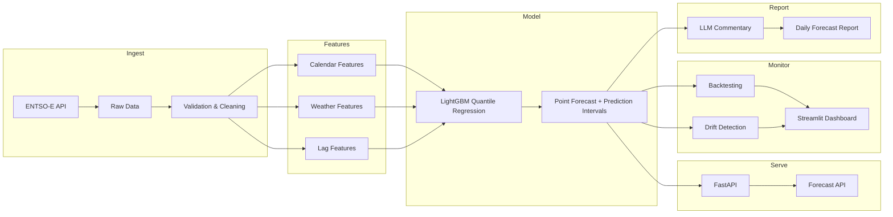

# GridCast

Probabilistic forecasting of Dutch hourly electricity load with prediction
intervals, backtesting, drift monitoring, automated retraining, and
LLM-generated daily forecast reports. Built on real data from the ENTSO-E
Transparency Platform and Open-Meteo.

**Status: Phase 4 (serving) complete.** Data pipeline, point and quantile
models, calibrated prediction intervals, a trust flag, and a gated FastAPI
service in Docker are built and tested; drift monitoring, scheduled
retraining and the dashboard are next - see roadmap.

## Why this project

In 2022 I built demand forecasting at a food company that hit 95% accuracy
against a 99% business threshold and never reached production. GridCast is
me doing it properly: the goal is a system where every component is tested,
monitored, and deployed - with honest evaluation and explicit uncertainty.

## Target architecture



The Ingest, Features and Model stages are built, including quantile
regression, conformal calibration and a trust flag; backtesting exists as
offline evaluation. Serve, drift detection, the dashboard and Report are
roadmap.

## What works today

One command builds a model-ready feature table from an empty data folder:

    uv run python -m gridcast.build --years 3

This fetches ~3 years of Dutch load (actual + TSO day-ahead forecast) at
native 15-minute resolution, caches it as monthly parquet, cleans it,
aggregates to hourly, joins population-weighted national weather and
calendar features, and writes `data/processed/features.parquet`
(~29,600 hourly rows as of 2026-11-15, 13 columns). Re-runs are idempotent: immutable
months and cached weather are skipped; recent months are refetched
because ENTSO-E revises recent actuals. `--offline` rebuilds everything
from the raw cache with no network.

On top of that, the modeling layer runs the full Phase 2 evaluation:

    uv run python -m gridcast.models.backtest      # baselines + SARIMAX, 140 folds
    uv run python -m gridcast.models.run_lgbm      # LightGBM on the same folds
    uv run python -m gridcast.models.run_ablation  # feature-group ablations
    uv run python -m gridcast.models.compare       # failure-mode breakdowns
    uv run python -m gridcast.models.run_holdout   # one-shot frozen holdout

and the Phase 3 probabilistic layer:

    uv run python -m gridcast.models.quantile_lgbm       # p10/p50/p90 on the 140 pinned folds
    uv run python -m gridcast.models.conformal           # conformal calibration of the intervals
    uv run python -m gridcast.models.trust               # trust-flag evaluation
    uv run python -m gridcast.models.run_holdout_phase3  # sealed holdout (one-shot; already spent)

and the Phase 4 serving layer:

    uv run python -m gridcast.models.export_artifact   # freeze models + conformal shifts at the configured cutoff
    uv run uvicorn gridcast.api.app:app --port 8000     # gated forecast API (or docker build/run)

## Results (Phase 2)

24h-ahead hourly forecasts, evaluated on 140 rolling-origin backtests
(5-day steps, expanding window, ~3 years of data) plus a frozen holdout
scored exactly once, after all modeling decisions were fixed:

| Model | Dev MAE (MW) | Holdout MAE (MW) | MAPE |
|---|---|---|---|
| LightGBM (lags + calendar + weather) | 270 | 297 | 2.2% |
| SARIMAX (Fourier terms + ARMA errors) | 667 | 569 | 4.2% |
| Seasonal naive (same hour last week) | 565 | 570 | 4.3% |

LightGBM roughly halves the error of the weekly seasonal naive and beat
it on 88.9% of holdout days; the dev-to-holdout degradation was +10%,
i.e. the backtest estimate was honest. Weather features use historical
actuals (perfect prognosis, stated below); the no-weather ablation
brackets production skill at 2.2-2.3% MAPE. The TSO day-ahead forecast
was evaluated as a feature and as a benchmark: for NL it is systematically
biased low (monthly median actual/TSO ratio 1.06-1.36, seasonal) as well
as amplitude-damped, adds no marginal accuracy as a feature, and was
dropped from the production configuration to remove a runtime dependency.

Averages are not the whole story - the per-horizon, per-hour, and
per-fold breakdowns live in `reports/phase2/`. The model's remaining
errors concentrate at midday and the evening ramp (weather-driven), and
its single worst backtest day (2024-12-16) was a warm winter Monday
where the learned temperature-demand relationship failed - the TSO's
forecast made the same directional error. That day is the motivating
example for the prediction intervals in Phase 3.

## Results (Phase 3)

Probabilistic 24h-ahead forecasts: one LightGBM quantile model per level
(p10/p50/p90), conformal calibration from the model's own recent
out-of-sample errors, and a trust flag. Scored on the same 140 pinned
folds as Phase 2; the median (tau = 0.5, which is the L1 objective)
reproduces Phase 2's model exactly (269.9 MW MAE), which validates the
pipeline end to end.

| | Raw quantiles | Conformal-calibrated | Sealed holdout (Aug 2026, calibrated) |
|---|---|---|---|
| 80% interval coverage | 63.0% | 79.1% | 73.6% |
| Median MAE (MW) | 269.5 | 259.0 | 243.2 |
| Mean pinball loss | 96.3 | 91.4 | 77.2 |
| Interval score | 1,541 | 1,448 | 1,101 |

Backtest columns use the 134 folds with calibration history. The holdout
(15 origins, weekly seasonal naive: 559 MW MAE) was scored exactly once.

- **The raw intervals were overconfident and biased low.** Conformal
  calibration (asymmetric CQR, trailing ~60 days, window fixed in advance;
  a 120-day sensitivity check agrees) fixes average calibration at the
  cost of 45% wider intervals. The proper scores improve, so the extra
  width is justified. Calibration is marginal, not conditional: nights end
  up over-covered, the evening peak under-covered, and after a bad episode
  the trailing window over-corrects.
- **Rare inside the training range is enough to fail.** No test hour was
  colder than its fold's training minimum, yet the median bias grows
  steadily into the cold tail (+383 MW in the coldest 2% of hours vs +92 MW
  in the middle). On holidays the model widens its own intervals (p90
  coverage 0.89); bridge days are missing from the calendar features.
- **Many of the worst misses were unforecastable.** Using the TSO forecast
  as an independent witness, the worst days were mostly missed by the TSO
  too, often by more.
- **Trust flag** (forecast-time signals: cold tail, irregular calendar
  days, recent calibration instability, input-data integrity): flags
  21.5% of hours; flagged hours show 43% higher median error and a 1.44x
  worse interval score, and capture 39% of the largest errors (1.8x lift).
  It predicts lower precision rather than interval failure. Thresholds
  were declared before evaluation but motivated by the same backtest, so
  these results are descriptive.
- **Behaviour after a data outage:** the first holdout week could only be
  calibrated on June errors (July was masked as corrupt at the time; it
  was later revised upstream, see the second finding) and covered 67%;
  once fresh August errors were available, coverage recovered to 80%.

Full numbers, method notes and caveats: `reports/phase3/RESULTS.md`.

## Phase 4: serving

A frozen model behind a FastAPI service in Docker. It serves exactly the
pipeline that was evaluated, and refuses requests it cannot answer
honestly.

```
docker build -t gridcast:local .
docker run --rm -p 8000:8000 gridcast:local     # docs at http://localhost:8000/docs
```

| Route | Returns |
|---|---|
| `GET /health` | artifact, training cutoff, data vintage, provisional boundary, servable range |
| `GET /model` | the artifact manifest: file hashes, library versions, git commit, conformal shifts |
| `GET /origins` | origins that pass every serving gate |
| `GET /forecast?origin=2026-10-05T00:00:00Z` | 24 hourly p10/p50/p90 in MW (calibrated 80% interval) with trust flags |

Example: for Monday 2026-10-05 at 19:00 local the service returns p50
15,740 MW with an 80% interval of 15,406-16,045 MW. Timestamps are given
in UTC and Europe/Amsterdam, but the window is the evaluated one:
origin at midnight UTC, 24 hours ahead.

**The artifact.** `python -m gridcast.models.export_artifact` freezes the
Phase 3 production pipeline at a training cutoff (`configs/serving.toml`,
currently 2026-10-01):

- three quantile models trained on origins before the cutoff, by the
  same function the backtest uses (no copied training loop);
- conformal shifts from 60 out-of-sample daily forecasts (2026-08-02 to
  09-30, one retrain per origin): p10 +5.5, p50 +109.9, p90 +236.9 MW.
  Raw 80% coverage on that pool was 64.2%, matching Phase 3's ~63%, so
  the overconfidence is stable - the condition a fixed shift relies on.
  The positive median shift is the trees lagging 2026 load, which runs
  3-6% above 2023-25;
- a reference forecast computed from the saved model files, and a
  manifest hashing every file plus the data, exclusions and config, with
  the git commit.

Models are LightGBM text files (no pickle), saved at their early-stopping
iteration; the save/load round trip differs by exactly 0.0 MW. Artifacts
are written to a `.partial` directory, renamed only when complete, and
never overwritten.

**Serving gates.** A request that fails a gate gets HTTP 422 with a
stable code, never a degraded forecast (malformed input gets FastAPI's
own validation error):

| Code | Refused when |
|---|---|
| `not_midnight_utc` | origin is not midnight UTC, or has no timezone |
| `before_cutoff` | origin precedes the training cutoff: the model trained on that day |
| `data_unavailable` | lookback load is missing |
| `excluded_data` | the 336 h lookback overlaps a data exclusion |
| `provisional_data` | the lookback reaches into the last 29 days before the data vintage |
| `weather_unavailable` | target-hour weather is missing |

The exclusions encode evidence about specific periods; the 29-day rule
(`configs/serving_gates.toml`) encodes the mechanism behind them (second
finding below), so it also covers windows nobody has inspected. On the
current data the two independently put the boundary at 2026-10-17: the
service answers 17 origins, 2026-10-01 to 10-17.

**Verification.**

- Parity: serving the artifact at its cutoff reproduces the export's
  reference forecast exactly - in-process, through the API, and from the
  Linux container over HTTP against a reference computed on Windows
  (max difference 0.0 MW).
- Leakage canaries: corrupting load, the TSO forecast and weather from
  the training cutoff on leaves the trained models' predictions
  bit-identical; corrupting load from a serving origin on leaves its
  forecast bit-identical.
- Fail-fast startup: a missing or modified model file (sha256 mismatch)
  stops the process instead of serving.
- Image: multi-stage, dependencies installed from `uv.lock` with
  `--frozen`, non-root (uid 10001), healthcheck on `/health`; a whitelist
  `.dockerignore` keeps `.env`, raw data and the local venv out.

**What this is not.**

- Not live forecasting: it replays a fixed data vintage, with no live
  ingestion, and weather features are observed weather (perfect
  prognosis). Live serving needs a forecast-weather source and the
  provisional-data handling above.
- The servable window is 17 days, bounded by the training cutoff and the
  provisional window.
- The model is frozen: a forecast for 2026-10-17 comes from a model 16
  days old, whereas every backtest fold retrained the day before.
- The calibration pool is out-of-sample but not a sealed holdout (it
  overlaps the spent August holdout); its raw q50 MAE of 246.6 MW is not
  a headline number.
- The image is 1.36 GB: it carries project dependencies serving never
  imports (statsmodels, polars).
- No authentication or rate limiting; one worker.

## Pipeline design

- **UTC everywhere, local time only as features.** The index is tz-aware
  UTC end to end; Europe/Amsterdam appears only transiently to derive
  calendar features, because load follows the local clock but gap
  detection and joins only make sense in UTC (every UTC day has 24
  hours; local days have 23 or 25 twice a year).
- **Detect and repair are separate.** `quality.py` only reports (gaps,
  duplicates, physical bounds, flatlines, spikes); `clean.py` repairs,
  and logs every repair with timestamps.
- **Sag vs. event.** Single-point outliers are repaired only when the
  value jumps >2 GW and immediately returns. A 4.5 GW drop that
  persisted (2026-06-25) is kept - it is data, not noise.
- **The day-ahead series is never value-repaired.** It is a covariate:
  the model must train on exactly what the TSO publishes, because that
  is what it receives at prediction time.
- **No silent row loss.** Covariates left-join onto the target spine;
  missing values stay visible as NaN and coverage is logged.

## Modeling design

- **Chronological evaluation only.** Random splits are invalid for
  forecasting: hourly load autocorrelation means randomly held-out
  hours have near-duplicate neighbours in training, so CV measures
  interpolation while production requires extrapolation. Everything is
  rolling-origin: train on `[start, origin)`, forecast
  `[origin, origin+24h)`, step forward, repeat.
- **The origin step must not alias the seasonality.** The original
  7-day fold step made every test day a Saturday; the step is 5 days
  (coprime with 7) so all weekdays are evaluated. Caught by reading
  the per-horizon error table, not by luck.
- **Evaluation windows are pinned, not derived.** The fold origins and
  holdouts live in `configs/evaluation.toml`, with a sealed/spent status
  per holdout; deriving them from "end of data" made them move on every
  refetch.
- **Corrupted data is masked, not dropped.** `configs/data_exclusions.toml`
  sets the target to NaN in known-bad periods, keeping the hourly grid
  intact for row-based rolling windows; forecasts whose inputs touch a
  masked period are not scored.
- **Leak-proof by construction, not by vigilance.** One feature builder,
  parameterized by forecast origin, generates both training rows
  (replayed historical origins) and inference rows. Rolling statistics
  are origin-anchored; lags unavailable at a given horizon are NaN in
  training and serving alike. A leakage canary test corrupts every
  target value at/after the origin and asserts zero feature bits change.
- **One direct model for all 24 horizons**, with horizon as a feature -
  horizons share structure, data is pooled, and trees split on horizon
  where behaviour differs.
- **Fixed conservative hyperparameters, no tuning on the backtest.**
  Selecting a config by re-running the folds and keeping the best table
  makes the folds the training signal for the config (evaluation-
  selection leakage) and overstates fresh-data skill. Early stopping
  uses a chronological (never random) validation slice.
- **SARIMAX as dynamic harmonic regression.** Classical SARIMA with
  s=168 is computationally infeasible and single-seasonal; Fourier
  terms for the 24h and 168h cycles + ARMA(2,1) errors on an 8-week
  trailing window handle both cycles cheaply. Its role is the honest
  classical-statistics control, not the product.

## A finding from the data

An initial physical lower bound of 4 GW for Dutch load flagged 368
"impossible" points. Investigation showed they were real: long smooth
runs at local hours 10-17, summer only, deepening year over year, down
to 327 MW - the midday collapse of *net* load driven by rooftop solar,
which sits behind the meter and subtracts from what ENTSO-E measures.
The fix was to the check (bound lowered to what remains physically
impossible), not to the data. Two genuine telemetry sags found in the
same investigation are repaired by the cleaning rules.

## A second finding from the data

The frozen holdout detected a live upstream data incident: from late
June 2026, ENTSO-E's published NL actual load collapsed to physically
implausible values while the TSO's independent day-ahead forecast stream
stayed normal. ENTSO-E has since revised late June, but July 2026 remains
corrupted (0.65x the same weeks in 2023-25), and the defect returned in
September 2026 (0.73x) with a clean August in between. Detection now
compares load with its own history rather than with the TSO stream,
which turned out to be biased low. The affected periods are masked via
`configs/data_exclusions.toml`, each with its reason and evidence. The
practical lesson feeds the serving phases: recently published actuals are
provisional and need plausibility gates and trailing-window
re-verification before a daily-retraining system may ingest them.

**Update (2026-11-16): not corruption - provisional publication.** A
refetch showed ENTSO-E had revised both months: July is now 1.60x and
September 1.42x the values first cached, both at the level of the clean
months around them (1.02-1.08x the same weeks in 2023-25). A third low
episode was in progress (from 2026-10-19, 0.75-0.85x, while the TSO
stream stayed normal). Lined up, the three episodes share one mechanism:
NL actual load from roughly the last 28 days before a fetch is published
20-35% low and corrected afterwards. The June 30 revision pins the
boundary: values were final from 13:45 UTC, 28 days before the 14:24 UTC
fetch. The "month-aligned" pattern was an artefact of when the data was
fetched. The fetch cache treats months older than 30 days as immutable,
so it would never have picked up the revision; only a deliberate refetch
found it. July and September are now unmasked (kept as history under
`[[resolved]]` in the exclusions config), the open window is excluded,
and the serving layer refuses any origin whose lookback touches the last
29 days of data (Phase 4). Phase 2 and 3 numbers are unaffected: the
backtest ends in May 2026 and its inputs were verified unchanged on the
revised data; both holdouts stay spent.

## Known limitations (deliberate, documented)

- Weather history is ERA5 reanalysis (what the weather *was*); in
  production the model will receive weather *forecasts*. This
  train/serve skew is accepted for now; training on historical
  forecasts is the rigorous upgrade. The no-weather ablation bounds
  the maximum possible impact.
- SARIMAX trains on an 8-week trailing window (compute budget for 140
  refits); LightGBM sees full history. Stated rather than hidden.
- The ENTSO-E day-ahead benchmark has an earlier information cutoff
  (~noon D-1) than our midnight origins, which slightly favours our
  models; the debiased variant uses realized actuals TenneT did not
  have, which cuts the other way. Both are footnoted, not corrected.
- Dutch school vacations (staggered across three regions) are not yet
  a feature; the worst backtest folds cluster on holiday-adjacent and
  DST-adjacent days. Bridge days are also missing.
- City weights for the national weather aggregate are approximate,
  Randstad-heavy; CBS population data would make them rigorous.
- The static lower load bound cannot catch a night-time sag to a few
  hundred MW; spike and flatline checks are the backstop.
- ENTSO-E NL actual load is provisional for ~28 days after publication
  (see second finding). Re-verification is a deliberate refetch: the
  fetch cache treats months older than 30 days as immutable, so
  revisions are not picked up automatically.
- Open-Meteo's archive API lags ~5 days behind real time, leaving
  recent hours without weather; production needs a fallback to the
  forecast endpoint. The weather cache also never refreshes on its own.
- Interval calibration is marginal only: hour-of-day and cold-tail
  conditional calibration are not solved.
- The trust flag was designed on the backtest it is evaluated on; its
  only out-of-sample test (August) contained no cold or calendar cases.
  Its instability signal uses a per-hour threshold that should be
  per-origin.
- Origins are midnight UTC, so horizon and hour of day are perfectly
  confounded in all per-horizon analyses.

## Project structure

    gridcast/
    |-- src/gridcast/
    |   |-- data/        # ENTSO-E client, weather, quality checks, cleaning
    |   |-- features/    # Calendar features, feature-table build
    |   |-- models/      # Splits, metrics, baselines, SARIMAX, LightGBM,
    |   |                # quantile models, conformal calibration, trust
    |   |                # flag, backtest harness, holdout evaluation,
    |   |                # serving-artifact export
    |   |-- serving/     # Artifact loading + integrity checks, gated forecaster
    |   |-- api/         # FastAPI app: /health, /model, /origins, /forecast
    |   |-- monitoring/  # (Phase 5) Drift detection, quality tracking
    |   |-- build.py     # One-command raw -> clean -> features pipeline
    |-- data/            # Raw & processed data (gitignored, reproducible)
    |-- models/          # Frozen serving artifacts (gitignored; hashed manifest)
    |-- notebooks/       # Exploration & diagnosis only - logic lives in src/
    |-- reports/         # Evaluation reports (phase2/, phase3/)
    |-- tests/           # 132 tests, no network required
    |-- configs/         # Data exclusions, evaluation windows, serving cutoff + gates
    |-- Dockerfile       # Serving image (multi-stage, non-root, healthcheck)

## Testing

`uv run pytest` - 132 tests, no network required. Highlights: DST
boundary behaviour on both switch days; rolling-origin folds proven
non-overlapping and midnight-aligned; Fourier regressors tested for
actual periodicity (which caught a timestamp-resolution bug that gave
the daily seasonal term a ~1000-day wavelength); a leakage canary that
corrupts every target value at/after the forecast origin and asserts
zero feature bits change; and a context-independence test proving a
feature row built alone (inference) is bit-identical to the same row
built during training replay. Phase 3 adds: the pinball loss's defining
property (its minimizer is the tau-quantile) checked numerically; the
interval score / pinball identity; rearrangement never increasing the
loss, row by row; a perturb-the-future test proving conformal
calibration never reads later folds; and an exclusion-soundness test run
against the real design-matrix builder. Phase 4 adds: a training-cutoff
canary (corrupting every input from the cutoff on leaves trained models
bit-identical); a serving canary (load from the origin on cannot reach
the forecast); every serving gate tested at its boundary; tamper
detection on model files; and parity between the served forecast and
the export's reference (skipped when the local artifact is absent).

## Setup

    # Install uv
    # Windows: powershell -ExecutionPolicy ByPass -c "irm https://astral.sh/uv/install.ps1 | iex"
    # Linux/Mac: curl -LsSf https://astral.sh/uv/install.sh | sh

    git clone https://github.com/AashishS97/gridcast.git
    cd gridcast
    uv sync
    cp .env.example .env   # add your free ENTSO-E API key
    uv run python -m gridcast.build --years 3

    # Serving (Phase 4)
    uv run python -m gridcast.models.export_artifact   # freeze the artifact (~20 min)
    uv run uvicorn gridcast.api.app:app --port 8000     # or docker build/run, see Phase 4

## Roadmap

1. ~~Data pipeline: ENTSO-E client, quality checks, cleaning, calendar +
   weather features, reproducible build~~ (done)
2. ~~Point models & backtesting: time-series splits, baselines, SARIMAX,
   LightGBM with leak-proof multi-horizon features, ablations, frozen
   holdout~~ (done)
3. ~~Probabilistic forecasts: LightGBM quantile regression, conformal
   calibration, failure analysis, trust flag, sealed holdout~~ (done)
4. ~~Serving: frozen artifact export, gated forecaster, FastAPI, Docker~~
   (done)
5. Monitoring & retraining: drift detection, scheduled retraining,
   Streamlit dashboard
6. LLM-generated daily forecast commentary

## Tech stack

Python 3.11, uv, pandas, LightGBM, statsmodels, FastAPI, Docker,
GitHub Actions, pytest, Streamlit. Data: ENTSO-E Transparency
Platform, Open-Meteo (ERA5). Anthropic/OpenAI API for forecast
commentary only.
