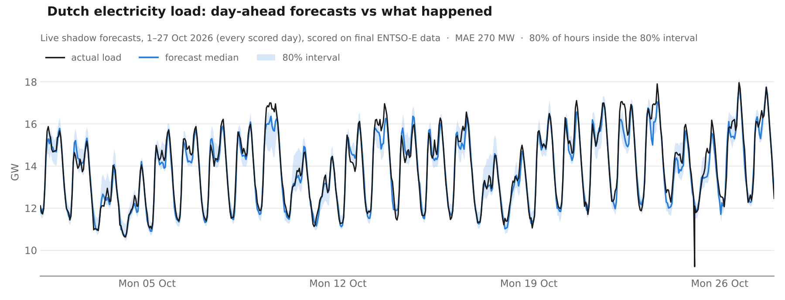
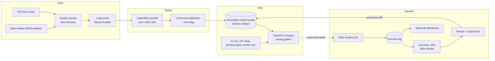

# GridCast

Probabilistic day-ahead forecasts of Dutch hourly electricity load, with the
parts a forecast needs after training: leak-proof backtesting, calibrated
prediction intervals, a gated API, CI/CD, daily monitoring on data the model
has not seen, and champion/challenger retraining.

[](https://github.com/AashishS97/gridcast/actions/workflows/ci.yml)
[](https://github.com/AashishS97/gridcast/actions/workflows/daily.yml)


| | |
|---|---|
| **Forecast API** | https://gridcast-7kic.onrender.com (free tier: the first request after 15 idle minutes takes about a minute) |
| **Monitoring dashboard** | https://gridcast-monitoring.streamlit.app (sleeps after 12 h without visitors) |
| **Live forecast log** | [`forecast-log` branch](https://github.com/AashishS97/gridcast/tree/forecast-log): every forecast, score, drift check and trial, appended daily |
| **Full project notes** | [`docs/PROJECT_NOTES.md`](docs/PROJECT_NOTES.md): each phase's method, numbers and caveats |



<sub>Every day in 1-27 October 2026 that the live system forecast and could
score, not a selected week. Scored once ENTSO-E's data for those days was
final. Generated from `hourly.csv` on the `forecast-log` branch.</sub>

## Why this project

In 2022 I built demand forecasting at a food company that hit 95% accuracy
against a 99% business threshold and never reached production. GridCast is
the same kind of problem carried all the way through: tested, deployed,
monitored and retrained, with the evaluation and the uncertainty stated
plainly. The monitoring and change control borrow from how banks manage
production models (ongoing monitoring, documented thresholds, escalation,
controlled model changes). This is an analogy, not regulatory compliance.

## What is built

All six phases are complete and running.

| Phase | What it delivered | Status |
|---|---|---|
| 1. Data pipeline | ENTSO-E load + Open-Meteo weather + calendar, one-command build | done |
| 2. Point models | seasonal naive, SARIMAX, LightGBM on 140 rolling-origin folds | done |
| 3. Probabilistic | quantile LightGBM, conformal calibration, trust flag | done |
| 4. Serving | frozen model bundle, FastAPI with refusal rules, Docker | done |
| 5. CI/CD | lint + tests, backtest regression gate, deploy to Render | done |
| 6. Monitoring and retraining | accuracy, drift, data checks, retrain + trial, dashboard | done; first trial verdict due Dec 2026 |

## Results

Target: Dutch national hourly load (about 10-18 GW), forecast 24 hours ahead
from midnight UTC.

### Point accuracy (median forecast)

| Evaluation | Model MAE | Seasonal naive MAE (same hour last week) | Notes |
|---|---|---|---|
| Backtest, 140 folds (2024-06-29 to 2026-05-25) | 270 MW (2.2% MAPE) | 565 MW | |
| Phase 2 frozen holdout, scored once | 297 MW | 570 MW | +10% vs backtest; beat the naive on 88.9% of days |
| Phase 3 sealed holdout (16-30 Aug 2026), calibrated | 243 MW | 559 MW | 15 origins, scored once |
| Live shadow, 1-27 Oct 2026 | 270 MW | 563 MW | skill 0.52 (95% band 0.42-0.59) |

Skill = 1 - MAE(model) / MAE(seasonal naive). A skill of 0.52 means the
model's error is about half the naive's.

### Prediction intervals (p10 / p50 / p90)

| | Raw quantiles | Conformal-calibrated | Sealed holdout (calibrated) | Live, Oct 2026 |
|---|---|---|---|---|
| Inside the 80% interval | 63.0% | 79.1% | 73.6% | 79.6% (band 73.6-85.2%) |
| Below p10 (target 10%) | 15.1% | 10% | 15% | 6.9% |
| Below p50 (target 50%) | 37.5% | 49% | 57% | 39.0% |
| Below p90 (target 90%) | 78.1% | 89% | 88% | 86.6% |
| Mean pinball loss (MW) | 96.3 | 91.4 | 77.2 | |
| Interval score (MW) | 1,541 | 1,448 | 1,101 | |
| Mean interval width (MW) | 680 | 985 | | 888 |

Backtest columns use the 134 folds with enough history to calibrate. The
seasonal naive is a point forecast, so it has no pinball loss or coverage to
compare. Calibration made the intervals 45% wider; pinball loss (-5%) and
interval score (-6%) both improved, so the extra width is earned. The live
band comes from resampling whole days. Full tables:
[`reports/phase3/RESULTS.md`](reports/phase3/RESULTS.md).

## Where the model fails

Found in the backtest and the live log. These are the failures that showed
up, not a list of plausible ones.

- **Cold hours.** The median under-forecasts more as it gets colder: +383 MW
  bias in the coldest 2% of hours against +92 MW in the middle of the range.
  No test hour was colder than the training minimum; being rare is enough.
- **Bridge days.** They are not in the calendar features. 2025-05-30 (the
  Friday after Ascension) was over-forecast by 416 MW.
- **Bad episodes.** Nov 2024, Jan 2026 and Mar 2026 each ran a +2.2-2.7%
  bias, with actuals below p50 only 11-14% of the time. The trailing
  calibration over-corrects the month after (-80 to -125 MW).
- **Worst single days.** 2026-03-11 (fold MAE 962 MW) was also missed by
  the TSO's own forecast, by more. 2024-12-16, a warm winter Monday (774 MW),
  is a day the seasonal naive got right (272 MW).
- **Afternoons and evening peak.** Before calibration, 15:00-18:00 local
  coverage was 45-57%. Calibration fixes the average, not each hour: live
  in October, 09:00-18:00 mostly sits at 59-81% and 19:00-23:00 at 89-96%
  (27 days, so each hour has only 27 samples).
- **Autumn drift.** The bias the calibration absorbs grew from +110 MW to
  +172 MW between August and late October 2026.

Holidays are handled reasonably: the model widens its own intervals
(1,299 vs 648 MW) and p90 coverage is 89%.

## Trust flag

Each forecast hour gets a flag when any of four signals, all known at
forecast time, fires:

| Signal | Rule | Share of backtest hours |
|---|---|---|
| `cold` | target-hour temperature in the bottom 10% of the training history | 14.9% |
| `calendar` | public holiday, bridge day, 24 or 31 December | 7.9% |
| `instability` | absolute conformal median shift above 2% of the forecast | 0.4% |
| `integrity` | a missing or excluded load hour in the 336 h lookback | 0% |

The flag marks 21.5% of backtest hours. Flagged hours have a median-forecast
MAE of 338 MW against 237 MW unflagged (+43%), a 1.44x worse interval score,
and hold 39% of the worst 10% of errors (lift 1.83). It predicts lower
precision, not interval failure: only 24% of out-of-interval hours are
flagged. The thresholds were set before evaluation but motivated by the same
backtest, so these results describe the backtest; they are not an
out-of-sample test. On the August holdout `instability` fired on 13.9% of
hours, all in the week calibrated on stale errors.

## Architecture



## How it was built

Each phase ends with something that runs. Details:
[`docs/PROJECT_NOTES.md`](docs/PROJECT_NOTES.md).

**1. Data pipeline.** `uv run python -m gridcast.build` builds the feature
table from an empty folder: ENTSO-E load at 15-minute resolution, cleaned
and aggregated to hourly UTC, joined with population-weighted weather and
Dutch calendar features. Detection and repair are separate, every repair is
logged, and no row is dropped silently.

**2. Point models and backtesting.** Rolling-origin evaluation only (random
splits leak in time series): 140 folds stepped every 5 days so every weekday
is tested, pinned in config so they never move. Seasonal naive, SARIMAX
(Fourier terms + ARMA errors) and LightGBM share one feature builder for
training and serving. A leakage test proves future data cannot reach a
feature. Hyperparameters are fixed, not tuned on the backtest.

**3. Probabilistic forecasts.** One LightGBM quantile model per level. Raw
intervals covered 63% for a nominal 80%; conformal calibration on the
model's own recent errors brings them to 79%. The trust flag is described
above.

**4. Serving.** A frozen, hashed model bundle behind FastAPI in Docker.
`/forecast` returns 24 hourly p10/p50/p90 values with trust flags. Requests
the model cannot answer honestly are refused with a stable error code
(provisional data, missing weather, before the training cutoff). Serving
reproduces the exported reference forecast exactly (0.0 MW difference), also
from the Linux container against a Windows reference.

**5. CI/CD.** Every push is linted and tested. Every pull request re-runs a
14-fold backtest on a frozen data snapshot and fails if pinball loss rises
more than 2%. A deliberately weakened model (`num_leaves` 63 to 2) passed
all unit tests and was caught only by this gate. Green commits on `main`
build the image, smoke-test it under the host's 512 MB limit, push it to
GHCR and deploy it to Render by exact commit.

**6. Monitoring and retraining.** A daily GitHub Actions job forecasts with
the served model, scores each forecast once its actuals are final, and
reports:

- **accuracy** with day-level bootstrap bands and traffic-light zones
  adapted from Basel backtesting (green inside the 95% band, red outside
  99.9%);
- **drift** (feature, target and concept) against a same-season reference,
  so autumn is compared with past autumns;
- **data checks** on a ledger of every ENTSO-E revision.

Retraining triggers on schedule (28 new final days) or on red, or amber
lasting 7 days. A challenger must pass seven static checks, then forecast
the same future days as the champion in a paired non-inferiority trial
(at most 2% worse on pinball loss, 14-28 paired days). Promotion is a
one-line pull request; rollback is reverting it.


## Engineering decisions

- **The ground truth arrives late and wrong.** ENTSO-E publishes Dutch load
  20-35% low for about 28 days, then revises it. I found this from a holdout
  that looked like a data outage, and later predicted a revision in advance.
  The API refuses any forecast whose inputs touch the last 29 days, and the
  monitoring scores a day only once it is final. The system judges itself
  about a month behind.
- **Uncertainty bands that respect correlation.** Coverage bands resample
  whole days, because a forecast's 24 hours tend to fail together. An hourly
  binomial gave a band about half as wide (79-86% vs 76-89% on the same
  window).
- **A fair comparison for retraining.** A freshly retrained model has no
  unseen past to be tested on, so champion and challenger forecast the same
  future days and are compared pair by pair once those days are final.
- **Models are releases.** Each bundle is an immutable GitHub release with
  file hashes; `configs/serving.toml` is the only place the champion is
  named. Every logged forecast records the bundle and the code commit.
- **Free to run.** GitHub Actions (public repo), Render free tier and
  Streamlit Community Cloud. Caching ENTSO-E months cut the daily job from
  about 25 minutes to 1-2.

## Findings from the data

- **Rooftop solar looks like "impossible" load.** A 4 GW lower bound flagged
  368 points that were real: midday net load fell to 327 MW in summer,
  lower each year, because solar behind the meter subtracts from measured
  load. The check was wrong, not the data.
- **Provisional publication, not corruption.** Three "corrupted" months
  were the same mechanism: the last ~28 days published low and revised
  later. Seen four times, once predicted in advance.
- **The TSO forecast is biased low.** Its monthly median actual/forecast
  ratio is 1.06-1.36. It added no accuracy as a feature and was dropped.
- **The checks caught a real bug.** A retrained challenger used four months
  less data than the champion because of a rolling fetch window. A recipe
  check now rejects that; the trial was closed as rejected and kept as
  evidence.

## Quickstart

```bash
# Install uv: https://docs.astral.sh/uv/getting-started/installation/
git clone https://github.com/AashishS97/gridcast.git
cd gridcast
uv sync
cp .env.example .env            # add a free ENTSO-E API key
uv run python -m gridcast.build # raw data -> features.parquet

uv run pytest                   # 237 tests, no network needed
uv run python -m gridcast.models.export_artifact            # freeze a model bundle (~20 min)
uv run uvicorn gridcast.api.app:app --port 8000             # API docs at localhost:8000/docs
uv run --with streamlit streamlit run dashboard/app.py      # dashboard
```

Or call the live API:

```bash
curl https://gridcast-7kic.onrender.com/health
curl "https://gridcast-7kic.onrender.com/forecast?origin=2026-10-05T00:00:00Z"
```

Other commands (backtests, ablations, calibration, gate, monitoring):
[command reference](docs/PROJECT_NOTES.md#phase-1-data-pipeline-and-command-reference).

## Project structure

    gridcast/
    |-- src/gridcast/
    |   |-- data/        # ENTSO-E client, weather, quality checks, cleaning
    |   |-- features/    # calendar features, leak-proof feature builder
    |   |-- models/      # baselines, SARIMAX, LightGBM, quantile models, conformal
    |   |                # calibration, trust flag, backtest harness, holdouts,
    |   |                # bundle export, candidate checks, CI regression gate
    |   |-- serving/     # bundle loading + integrity checks, gated forecaster, daily log
    |   |-- api/         # FastAPI: /health, /model, /origins, /forecast
    |   |-- monitoring/  # accuracy bands and zones, drift and data checks,
    |   |                # retraining policy and trials, run health
    |   |-- build.py     # one-command raw -> clean -> features pipeline
    |-- dashboard/       # Streamlit monitoring dashboard (reads forecast-log)
    |-- configs/         # evaluation windows, exclusions, serving bundle, gates, monitoring thresholds
    |-- tests/           # 237 tests, no network required
    |-- reports/         # evaluation reports (phase2/, phase3/)
    |-- docs/            # project notes, images
    |-- notebooks/       # exploration only; logic lives in src/
    |-- Dockerfile       # multi-stage, non-root, healthcheck
    |-- .github/workflows/
    |   |-- ci.yml             # lint + test; image build, smoke test, deploy on main
    |   |-- backtest-gate.yml  # regression gate on pull requests
    |   |-- daily.yml          # shadow forecast, scoring, monitoring, challenger trial
    |   |-- retrain.yml        # build a challenger: decide, export, check, prerelease

## Testing

237 tests, no network needed. The ones that carry the most weight:

- **Leakage tests:** corrupting every value at or after a forecast origin
  (or a training cutoff) leaves features, trained models and forecasts
  bit-identical.
- **Training/serving parity:** a feature row built alone at inference is
  bit-identical to the same row built during training, and the served
  forecast reproduces the export's reference exactly.
- **Statistics checked against known answers:** the pinball loss is
  minimised at the quantile; a day-resampled band is wider than a binomial
  on correlated days; every traffic-light zone at its boundaries.
- **Pipeline guards:** every serving gate at its boundary, tamper detection
  on model files, each candidate check failing on exactly its defect, and
  the trial promoting, rejecting or waiting as specified.

Full list: [testing in detail](docs/PROJECT_NOTES.md#testing-in-detail).

## Limitations

- **One country, one target.** Dutch national load only; nothing here is
  tested on other countries, regions or on generation or prices.
- **Not a live day-ahead forecaster.** Inputs need final data, so the system
  runs about 30 days behind real time.
- **Perfect-prognosis weather.** Training and evaluation use observed (ERA5)
  weather. A real forecaster gets weather forecasts and would be less
  accurate; all accuracy numbers here are an upper bound. A no-weather
  ablation brackets the effect at 2.2-2.3% MAPE.
- **One backtest period.** The folds span June 2024 to May 2026 and
  neighbouring folds share most of their training data, so the effective
  sample is well below 140. The two holdouts are 15 days (August) and the
  Phase 2 window; the live record is one month so far.
- **Calibration is marginal, not per hour** (see failures above).
- **The trust flag is evaluated in-sample.** Its only out-of-sample test
  (August) had no cold or calendar hours.
- **Horizon and hour of day are confounded,** because every forecast starts
  at midnight UTC.
- **One-person governance.** The person who approves a promotion built the
  model; there is no independent validator.
- **Not yet exercised live:** the red-zone escalation path (unit-tested,
  never triggered) and a completed champion/challenger trial (first verdict
  expected December 2026).

More: [known limitations](docs/PROJECT_NOTES.md#known-limitations-deliberate-documented).

## Future work

Per-hour conformal calibration; training on archived weather forecasts
instead of observed weather; Dutch school holidays and bridge days as
features; actions pinned by commit SHA.

## Data sources and licences

- **Electricity load:** [ENTSO-E Transparency Platform](https://transparency.entsoe.eu/),
  actual total load for the Netherlands (bidding zone `10YNL----------L`).
  Used under the platform's Terms and Conditions; since 2019 the TSOs
  release this data for reuse under ENTSO-E's open data policy. Values are
  as published by ENTSO-E, including the provisional-then-revised behaviour
  described above.
- **Weather:** [Open-Meteo](https://open-meteo.com/) Historical Weather API
  (ERA5 reanalysis), data licensed
  [CC BY 4.0](https://creativecommons.org/licenses/by/4.0/); used on the free
  non-commercial tier. Values for several Dutch locations are combined
  into a population-weighted national average. Contains modified
  Copernicus Climate Change Service information.

## Tech stack

Python 3.11, uv, pandas, LightGBM, statsmodels, FastAPI, Docker, GitHub
Actions, GitHub Container Registry, Render, Streamlit, Altair, pytest, ruff.

## Author

Aashish Siddarth, data scientist.
[LinkedIn](https://www.linkedin.com/in/aashish-siddarth-1690a7180) ·
[GitHub](https://github.com/AashishS97)
